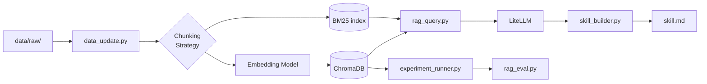

# CypherOG：街舞知識 RAG 系統

> **English summary.** CypherOG is a retrieval-augmented question-answering assistant for Popping and funk-style street dance. It cleans 42 documents (Wikipedia articles, event rulebooks, articles, two academic PDFs and my own notes; the April five-setup comparison used the first 39), splits them into paragraph-aware chunks, embeds them locally with a multilingual sentence-transformer into ChromaDB, retrieves by dense search (optionally fused with BM25 through reciprocal rank fusion, or widened by LLM query expansion), and answers through LiteLLM with a chain-of-thought prompt that cites a source for every claim.
> **Role:** individual project. I built the ingestion pipeline, retrieval and prompts. The November 2026 extension (retrieval fixes, tests, the evaluation harness that compares retrieval setups on five fixed questions with pre-registered metrics, and the round-2 experiments in [experiments/](experiments/README.md)) was built with an AI coding agent (Claude Code) under my direction.
> **Run:** `pip install -r requirements.txt`, put `OPENAI_API_KEY` and `LITELLM_MODEL` (or a LiteLLM proxy) in `.env`, then `python data_update.py --rebuild` and `python rag_query.py -q "Who founded the Electric Boogaloos?"` (add `--hybrid` for BM25 fusion). Tests: `python -m pytest`.

**Key results** (five fixed questions; details and caveats in [experiments/README.md](experiments/README.md)):

| Comparison | Result |
|---|---|
| Five setups on 39 documents (Apr 2026, reproduced exactly with today's code: 25/25 retrievals) | The setup with 300-character chunks cut mean cosine distance by 10% (0.359 vs 0.399), yet its answer named 2 of the 9 Electric Boogaloos members versus the baseline's 9. Distance is not answer quality. |
| BM25 + dense via reciprocal rank fusion vs dense only (Nov 2026, same 39 documents, 3 runs each) | Hybrid retrieval found Juste Debout facts that every dense-only setup missed, and its answers stated them (3/3 runs; the key chunk sat at cosine distance 0.798, outside dense reach), though none covered the event's rules; it also named 3 of 9 members where dense retrieval named 9. It therefore ships as the opt-in `--hybrid` flag. |
| Adding my three curated Chinese notes (42 documents) | Plain dense retrieval then found Juste Debout facts as well, without losing any members. |

---

## 1. 專案簡介

### 知識主題與選擇理由

我已經跳街舞（Popping / Funk Style）七年，參加過多場賽事，包括 1v1 Battle、雙人賽（Duo）、團隊賽（Crew）等。街舞圈非常重視「傳承」這件事——每位老師、前輩都強調要了解 Funk 音樂的根源、各流派的歷史脈絡，以及 Fresno 那個年代如何誕生這個文化。

然而街舞知識的現況是：**散落在 YouTube 訪談、個人部落格、Reddit 討論串、Wikipedia 條目與賽事官網，從未被整理成正式文件**。新手很難有系統地認識 Electric Boogaloos、Popin' Pete、Salah 這些傳奇人物，也不清楚 Boogaloo、Waving、Tutting、Turfing 各流派的技術差異與歷史關係。

這個 RAG 系統正是為了解決這個痛點——把分散各地的 Popping 知識集結成一個可查詢的個人知識庫，角色定位為 **CypherOG**（OG = Original Gangster，指老前輩、知識傳人）。

此外，我目前正在開發街舞活動購票平台 [CypherHub](https://github.com/DancinAndrew/CypherHub)（[線上版本](https://cypher-hub.vercel.app/)），未來計劃將此 RAG 助手整合進平台，作為嵌入式 AI 顧問，讓參加 Battle 的舞者能直接詢問賽事規則、舞風文化或賽事歷史。

### 資料來源規模

| 格式 | 數量 | 說明 |
|------|------|------|
| Markdown（`.md`）| 39 份 | Wikipedia 條目、舞蹈資訊網站、賽事官網、社群文章、個人筆記 |
| 純文字（`.txt`）| 1 份 | 個人整理的 Popping 術語摘錄 |
| PDF（`.pdf`）| 2 份 | 學術論文（Dance Studies、Hip-Hop 舞蹈史） |
| **合計** | **42 份** | |

其中三份個人整理的中文筆記（`popping_glossary.md`、`popping_history_timeline.md`、`popping_style_taxonomy.md`）是在第一輪實驗（2026 年 4 月）之後才加入的，所以第一輪實驗的語料是 **39 份**。這一點是用重現實驗確認的：排除這三份後，今天的程式能逐筆重現第一輪全部 25 組檢索結果；納入時只有 11 組相同（見 [experiments/round1_reproduction.md](experiments/round1_reproduction.md)）。

資料涵蓋：Popping 起源（1970s Fresno）、各技術流派、重要人物傳記、賽事規則（HHI、Juste Debout、Red Bull Dance Your Style）、組織介紹（Infinite Force、Electric Boogaloos）、Funk 音樂文化背景，以及當代舞者（Marquese Scott、Salah）的風格分析。

### RAG 系統架構與技術選型

```
data/raw/（.md / .txt / .pdf，42 份）
  │  extract_clean_text()      移除 HTML 標籤、壓縮多餘空白；PDF 以 pypdf 抽字
  │  chunk_text()              段落感知遞迴切割（\n\n 優先）+ overlap
  │  embed_texts()             sentence-transformers 本地 384 維向量（每個 chunk 只讀前 128 tokens）
  ├▶ ChromaDB（cosine）        持久化向量索引
  └▶ BM25 索引（JSON）          每個 collection 一份，供 Hybrid Search 使用

rag_query.py
  │  embed_texts([query])      query 向量化
  │  coll.query(top_k, distance ≤ 0.65)   向量檢索 + 距離過濾
  │  （可選）--hybrid           BM25 與向量結果以 Reciprocal Rank Fusion 合併
  │  （可選）--expand-query     LLM 把問題改寫成多個子查詢後合併
  │  build_messages()          CoT prompt，XML 標籤分隔 context / question
  └▶ LiteLLM → OpenAI-compatible proxy 或供應商金鑰 → LLM
```

技術選型核心考量：**embedding 與向量庫完全本地執行、跨平台可重現**；只有生成回答需要 LLM 金鑰。

---

## 2. 系統架構



### 目錄結構

```
.
├── data/
│   ├── raw/              # 原始文件（42 份：.md / .txt / .pdf）
│   ├── processed/        # 清理後純文字（已提交；實驗以這份文字建索引）
│   └── .ingest_manifest.json  # 增量更新 SHA-256 hash 紀錄（.gitignore 排除）
│
├── chroma_db/            # ChromaDB 向量庫與各 collection 的 BM25 索引（.gitignore 排除）
│
├── data_update.py        # 資料管線：清理 → chunk → embed → 寫入向量庫與 BM25 索引
├── rag_query.py          # 問答 CLI：檢索（向量／hybrid／query expansion）→ LiteLLM 生成
├── skill_builder.py      # 知識庫摘要 → skill.md
├── rag_common.py         # 共用設定（路徑、embedding、Chroma、BM25、LiteLLM）
├── experiment_runner.py  # 實驗：每組設定重建索引、跑固定 5 題、輸出結果
├── rag_eval.py           # 評估：事前登錄的指標、重現檢查、metrics.md
│
├── experiments/          # 第一輪（combo_a–e、summary.md）、重現檢查、第二輪（round2/）、指標
├── tests/                # pytest（chunking、RRF、BM25 索引、hybrid、實驗與評估）
├── requirements.txt
├── .env.example
└── skill.md              # 由 skill_builder.py 生成
```

---

## 3. 設計決策說明（Design Decisions）

> 本節的設計決策以兩輪實驗佐證。所有數字都來自 `experiments/` 中的程式輸出；設定與指標的完整說明見 [experiments/README.md](experiments/README.md)。

### 3.0 決策方法論：兩輪對照實驗

**第一輪（2026 年 4 月）**：設計 5 種策略組合（A–E），各自對同一份 39 份文件的語料全量重建索引，並以固定 5 道測試題（起源知識、細節列舉、概念比較、特定賽事、評判標準）評估。回答由 gemini-2.5-flash（課程提供的 LiteLLM proxy）生成。

**重現檢查（2026 年 11 月）**：用今天的程式與同一份 39 份語料重跑 A–E 的檢索（不呼叫 LLM），25 組檢索的 chunk、順序與距離全部與第一輪記錄一致（距離差 ≤ 0.0005）。

**第二輪（2026 年 11 月）**：以 E 為對照（E′），加跑 F（Hybrid Search）與 G（Query Expansion），每組重複 3 次，主要語料為同一份 39 份（與第一輪可直接比較），另在目前的 42 份語料上各跑 3 次。回答由 gpt-4.1-mini-2025-04-14 生成。評估指標在跑第二輪之前就寫進 `experiments/gold.json` 並提交。

| 組合 | Chunking | top-k / max_dist | 特殊策略 | Prompt 風格 |
|------|----------|-----------------|--------|-------------|
| **A — Baseline** | naive 500/0 | 5 / 1.0（無過濾） | — | 弱 |
| **B — 段落感知+距離** | recursive 600/100 | 5 / 0.65 | — | 弱 |
| **C — 大 chunk+強** | recursive 1200/200 | 3 / 0.65 | — | 強（XML） |
| **D — 小 chunk** | recursive 300/50 | 10→5 / 0.5 | top-10 依距離截斷為 5（等同 top-5） | 強（XML） |
| **E — CoT** | recursive 600/100 | 5 / 0.65 | — | CoT（XML） |
| **F — Hybrid Search**（第二輪） | recursive 600/100 | 5 / 0.65（只作用於向量通道） | BM25 + 向量，RRF 融合 | CoT |
| **G — Query Expansion**（第二輪） | recursive 600/100 | 5 / 0.65（各子查詢） | LLM 改寫成子查詢後合併 | CoT |

> 注意：D 相對 A 同時改了五項（切割法、chunk 大小、top-k、距離門檻、prompt），所以 D 的距離差不能歸因於任何單一設定。第一輪輸出中 D 標示的「Rerank 是」實際上只是依同一個 cosine 距離排序後截斷，沒有使用 reranker 模型，結果等同直接取 top-5。

**實驗結果**（五題平均 cosine 距離；Q2 = 回答點名 Electric Boogaloos 九位成員中的幾位；Q4 = Juste Debout 問題，檢索到含賽事事實的 chunk 數／回答說出的事實類別數）：

| 組合 | 語料 | 平均距離 | Q2 成員（/9） | Q4 chunk | Q4 事實類別 |
|------|------|---------|--------------|---------|------------|
| A（第一輪） | 39 份 | 0.399 | 9 | 0/5 | 0 |
| B（第一輪） | 39 份 | 0.386 | 9 | 0/5 | 0 |
| C（第一輪） | 39 份 | 0.384 | 3 | 0/3 | 0 |
| D（第一輪） | 39 份 | 0.359 | 2 | 0/5 | 0 |
| E（第一輪） | 39 份 | 0.386 | 9 | 0/5 | 0 |
| E′（第二輪 ×3） | 39 份 | 0.386 | 9 | 0/5 | 0 |
| F（第二輪 ×3） | 39 份 | 0.443 | 3 | 2/5 | 2–3 |
| G（第二輪 ×3） | 39 份 | 0.466–0.474 | 0–2 | 1/5 | 1–2 |
| E′（第二輪 ×3） | 42 份 | 0.379 | 9 | 1/5 | 3 |
| F（第二輪 ×3） | 42 份 | 0.460 | 4 | 1/5 | 3 |
| G（第二輪 ×3） | 42 份 | 0.463–0.471 | 1–2 | 1/5 | 1–2 |

**最終選用策略**：預設使用 Combo E（段落感知 600/100、top-5、0.65、CoT prompt）。`--hybrid`（F）與 `--expand-query`（G）保留為可選模式：F 能找回向量檢索漏掉的專有名詞內容，但會犧牲列表類問題的完整度；G 的效果不穩定（詳見 3.4 節）。

---

### 3.1 Chunking 策略

**選擇：段落邊界優先的遞迴切割（recursive splitter），size=600，overlap=100**

演算法流程：

1. 優先以 `\n\n`（段落）切分 → 次選 `\n` → 再選 `。` → 再選 `.` → 空格 → 最後字元兜底
2. 若一個段落超過 `CHUNK_SIZE=600` 字元，遞迴往下一層 separator 細分
3. 每個 chunk 加 `CHUNK_OVERLAP=100` 字元前綴（取上一 chunk 末尾），保留跨 chunk 的語義連貫
4. Metadata 額外記錄 `section_title`（從最近的 `#`～`###` heading 萃取）與 `char_offset`（字元偏移量），方便溯源

**實驗佐證：**

- Q1「What is Popping and who created it?」：Combo B（recursive 600）平均 chunk 距離 **0.3548**，Combo A（naive 500）為 **0.3873**，平均距離下降 **8.4%**。這只是 Q1 一題的檢索距離，不是精準率（precision）。
- Q2「Electric Boogaloos 成員列舉」：Combo D（size=300）距離最低，但回答只提到 Boogaloo Sam 和 Pete，**遺漏了 Skeeter Rabbit、Suga Pop、Mr. Wiggles 等 7 名成員**；Combo B 與 E 的回答列出全部 9 位。
- Q2 同題：Combo C（size=1200）保留了較完整的段落，回答提到 Suga Pop 與 Michael Jackson 合作等細節，但 top-k=3 讓覆蓋面較窄，只點名 3 位成員。

**600 字元與 embedding 長度上限：**

`paraphrase-multilingual-MiniLM-L12-v2` 的 `max_seq_length` 是 **128 tokens**，超過的部分在 embedding 時會被截掉（LLM 仍會看到完整 chunk，只是向量檢索看不到後段）。以第一輪的 39 份語料實測：

| Chunking | chunk 數 | token 中位數 | 超過 128 tokens 的比例 | 平均被 embed 的比例 |
|---|---|---|---|---|
| D：300/50 | 2,494 | 82 | 5% | 約 100% |
| A：naive 500 | 1,102 | 154 | 76% | 84% |
| B／E：600/100 | 1,248 | 164 | 75% | 78% |
| C：1200/200 | 611 | 334 | 93% | 45% |

所以 600 不是掃描出來的最佳值，而是一個折衷：它在 A–E 中保住了成員名單這類有序列表的完整，同時每個 chunk 平均約 78% 的內容能被向量檢索讀到。Size=300 能被完整 embed（這可能是 D 距離最低的原因之一），卻把列表切碎；size=1200 平均只有 45% 的內容進入向量，後段對檢索來說等於不存在。

**Overlap=100 的理由：**

Popping 歷史文章中有大量「A 人物→B 事件→C 影響」的連貫敘事，100 字 overlap 可保留上一段末尾的主語，避免新 chunk 開頭因缺乏主語而語義不完整。

---

### 3.2 Embedding 模型選擇

**選用 `sentence-transformers/paraphrase-multilingual-MiniLM-L12-v2`（本地，免費）**

| 方案 | 取捨評估 |
|------|---------|
| **multilingual-MiniLM-L12-v2（選用）** | 384 維、完全本地免費、支援中英文混合；首次下載後可離線使用；每個輸入只讀前 128 tokens |
| all-MiniLM-L6-v2（HuggingFace） | 英文模型，無法處理中文提問 |
| nomic-embed-text（Ollama） | 需另行安裝 Ollama server，增加環境依賴；768 維較大但本專案規模效益不明顯 |
| text-embedding-3-small（OpenAI） | 付費，且本地執行目標下不引入外部 API 依賴，直接排除 |

**中英文混合處理的具體考量：**

語料以字元計約 99% 是英文，中文只出現在我自己整理的筆記裡；但我習慣用中文提問，例如「Electric Boogaloos 的成員有哪些？」問的是英文資料。所以 embedding 必須能把中文問題和英文段落對齊，這是選擇 multilingual 模型的原因。這個跨語言缺口在實驗中確實存在：Q4「Juste Debout 比賽的規則和歷史？」在第一輪五組都答不出來（見 3.4 節）。

**本地 vs API 的取捨：**

- 本地：無配額限制、可離線、資料不離開本機
- API（HuggingFace Inference API / OpenAI）：無需下載模型、可用更大的模型，但有速率限制和費用

本專案選本地，理由是可重現性：clone 後不需要任何 API Key 就能建立索引與檢索。

---

### 3.3 Vector DB 選型

**選用 ChromaDB（Pure Python 持久化向量庫）**

| 方案 | 特色 | 適配性評估 |
|------|------|------------|
| **ChromaDB（選用）** | Pure Python、零 Docker、cosine / L2 / IP 距離、支援 metadata filter | ✅ 最佳：pip install 即用，無需 server |
| pgvector | SQL 查詢力強、業界主流 | ❌ 需 Docker + PostgreSQL，增加環境複雜度 |
| Qdrant | REST API、高效能、Docker 或 cloud | ❌ 需 Docker 且非 Python-native |
| FAISS | 純向量索引、速度最快 | ❌ 只負責向量搜尋，持久化與 metadata（來源檔、chunk 編號）都要自己管理 |

以第一輪的 39 份語料、600/100 切割，共 1,248 個 chunks（目前 42 份為 1,279 個）；在 M 系列 Mac 上單次 top-5 查詢（不含問題的 embedding）中位數延遲約 1.2 ms。增量更新時以 `where={"source_file": ...}` 刪除舊 chunks，即利用 Chroma 的 metadata filter。

---

### 3.4 Retrieval 策略

**選擇：top-k=5，MAX_DISTANCE=0.65，預設純向量檢索**

**top-k=5 的根據：**

街舞知識問題通常涉及 2–4 個相關段落。5 個 chunk 保留適度 buffer，又不至於讓不相關 chunks 佔比過高、讓 LLM 混淆。

**MAX_DISTANCE=0.65 的角色：**

0.65 是給「知識庫沒有涵蓋的問題」用的安全網，不是在測試題上調出來的值。第一輪所有被取回的 chunk 距離都 ≤ 0.498，所以這個門檻在五道測試題上從未觸發。用四個與街舞無關的問題測試：「如何烤出好吃的麵包？」「量子電腦如何運作？」「台北明天會下雨嗎？」最近的 chunk 距離分別為 0.758、0.656、0.694，全部被過濾，系統直接回答資料未涵蓋；但「What is the capital of France?」仍保留一個 0.630 的 chunk（語料提到 Juste Debout 在巴黎舉辦）。相對地，「Popin' Pete 是誰？」最近的 chunk 距離為 0.262。

**距離變小不代表答案更好（Combo D 的教訓）：**

Combo D 的五題平均距離最低（**0.359**，比 Baseline 的 0.399 低 10%），但在 Q2 只點名 2 位成員，Baseline 則點名 9 位。原因是 300 字的 chunk 把成員名單切成碎片，名單所在的片段沒有進入前 5 名。再加上 D 同時改了五項設定，這 10% 也不能歸因於 chunk 大小。對本知識庫（大量有序列表的舞蹈百科文章）而言，**保持 chunk 完整比追求更低的檢索距離重要**。

**進階策略一：BM25 Hybrid Search（`--hybrid`，Combo F）**

純向量搜尋對罕見專有名詞的精確匹配較弱。BM25（詞頻統計）會直接匹配包含 "Juste Debout"、"Popin' Pete" 等字串的 chunk。兩者以標準的 **Reciprocal Rank Fusion**（Cormack et al., 2009）合併：

```
score(chunk) = 1 / (60 + 向量名次) + 1 / (60 + BM25 名次)     （某一方沒找到該 chunk 時，該項為 0）
```

- 向量通道取前 15 名（套用 0.65 距離門檻）；BM25 通道取分數 > 0 的前 15 名，不套用距離門檻。
- 只被 BM25 找到的 chunk 會回報它與問題的真實 cosine 距離。
- BM25 索引每個 collection 一份（`chroma_db/bm25_<collection>.json`），全量重建與增量更新後都會重建。

第二輪結果（39 份語料，3 次的檢索結果完全相同）：F 是唯一取回 Q4 事實的組合，5 個 chunk 中有 2 個含 Juste Debout 的事實；3 次回答都說出地點（巴黎）與場館（Accor Arena），其中 1 次另外說出雙人賽制，且都能在取回的段落中找到出處。關鍵的 `Juste Debout.txt` 第 0 段與問題的 cosine 距離是 0.798，遠在向量檢索與門檻之外，只有 BM25 的字面匹配能找到它。

代價是 Q2：RRF 讓兩個檢索器都找到的 chunk 排在前面。成員名單所在的段落在向量檢索排第 5，但不在 BM25 的前 15 名，融合分數只有 1/65 ≈ 0.0154；Suga Pop 條目的段落在向量檢索只排第 15，因為 BM25 排第 6，融合分數 0.0285 反而進入前 5。名單段落因此被擠出，回答只點名 3 位成員。

> 修正紀錄（2026-11）：最初的實作是 0.7 × 1/(60+向量名次) + 0.3 × 1/(60+BM25 名次)，缺席名次記為 1000。這讓只被 BM25 找到的 chunk 最高只有約 0.0056 分，低於任何向量候選（≥ 0.0096），所以 BM25 實際上只會重排向量結果、永遠加不進新 chunk；BM25-only 的 chunk 也被填了 0.9 的假距離。現在改為上式的標準 RRF。

**進階策略二：Query Expansion（`--expand-query`，Combo G）**

中文提問英文內容（例如「震感舞是誰發明的？」）存在跨語言召回缺口。Query Expansion 用 LLM 將原始問題改寫為最多 3 個不同角度的子查詢（含英文版本），每個子查詢各自向量搜尋並套用距離門檻，再去重合併：同一個 chunk 被多個子查詢找到時保留最小距離，依距離排序後取前 5。

```
原始查詢：「震感舞是誰發明的？」
擴展查詢：["Who created Popping dance?", "Boogaloo Sam Fresno history", ...]
結果：各子查詢分別搜尋 → 去重（保留最小距離）→ 距離排序 → 取前 5
```

第二輪結果（39 份語料）：G 在 Q4 找回 1 個含 Juste Debout 事實的 chunk、回答說出 1–2 類事實，但 Q2 只點名 0–2 位成員，3 次之間也不穩定。子查詢的距離是相對於各自的子查詢，所以 G 的上下文中可能出現與原始問題距離超過 0.65 的段落。

**為什麼平均距離不能評估 F 與 G：** 在 k 固定時，純向量的 top-k 本來就是距離總和最小的集合，任何融合或擴展只會讓平均距離持平或變大（F 0.443、G 約 0.47，E′ 0.386）。所以第二輪改用「找回了什麼」作為指標，並在實驗前先登錄。

使用方式：

```bash
python rag_query.py --query "Juste Debout 比賽的規則和歷史？" --hybrid
python rag_query.py --query "震感舞是誰發明的？" --expand-query
```

**資料比檢索技巧更有效：** 在加入三份中文整理筆記的 42 份語料上，純向量的 E′ 就能從時間線筆記找到 Juste Debout 的資料並說出 3 類事實，同時保留 9 位成員；F 在這份語料上對 Q4 沒有額外幫助，Q2 只點名 4 位。

---

### 3.5 Prompt Engineering

**選擇：Chain-of-Thought (CoT) + XML 標籤分隔（Combo E 策略）**

系統最終使用的 prompt 結構：

```
系統角色（system prompt）：
  你是嚴謹的知識庫查詢助理。
  規則：
  Step 1 — 列出 Facts：從 <context> 逐條摘錄相關事實，每條附 [來源 n]
  Step 2 — 綜合回答：根據上述 Facts 組成連貫答案，每個陳述附 [來源 n]
  Step 3 — 缺口說明：無法回答的部分明確標示「資料未涵蓋」
  禁止引用 <context> 以外的任何知識

使用者訊息（user message）：
  <context>
  [retrieved chunks，含來源標籤]
  </context>

  <question>
  [使用者查詢，已截斷至 500 字元]
  </question>
```

**CoT 與 strong prompt（Combo C/D）的比較：**

| 面向 | Combo C/D（強規則） | Combo E（CoT） |
|------|---------------------|----------------|
| Q1 引用完整度 | 每段有 [來源 n] | 每段有 [來源 n] |
| Q2 成員列舉 | 取決於檢索結果（C 3 位、D 2 位） | 9 位；與檢索相同、弱 prompt 的 B 也是 9 位，差別主要來自檢索 |
| Q5 知識缺口 | 直接回答 | Step 3 明確標示「資料未涵蓋具體的所有評分標準的詳細列表」 |
| 結構透明度 | 直接輸出答案 | Facts → 綜合 → 缺口，**可審計推理過程** |

Combo E 與 B 的檢索結果完全相同，差別只在 prompt：B（弱 prompt）的 Q5 回答雖簡潔，但**沒有揭示知識缺口**；E 會在 Step 3 說出資料沒有涵蓋的部分。

**XML 標籤與輸入長度限制：**

`<context>` 與 `<question>` 標籤讓模型較容易分辨「檢索資料」與「使用者問題」，system prompt 也要求忽略試圖讓它偏離規則的指令；這能降低、但不能防止 prompt injection（使用者仍可在問題中輸入 `</question>` 之類的文字）。`query` 另外被截斷為最多 500 字元，限制注入內容的長度。

**temperature=0.2 的理由：**

Popping 歷史是事實問答（人名、時間、地名），需要低隨機性。temperature=0 完全確定性但容易過度保守；0.2 保留少量彈性以應對語言多樣性。

---

### 3.6 Idempotency（冪等性）設計

`data_update.py` 的兩層冪等保證：

**層一：增量更新（無 `--rebuild` 時的預設行為）**

```
data/.ingest_manifest.json  ← SHA-256 hash 記錄表
```

1. 讀取 manifest，對每個 `data/raw/` 檔案計算當前 SHA-256
2. hash 相同 → 跳過（不重新 embed）
3. hash 不同或新增檔 → 刪除 ChromaDB 中舊有的對應 chunks（by `source_file` metadata 過濾）→ 重新處理後寫入
4. 最後依 collection 目前的全部 chunks 重建 BM25 索引，避免詞頻索引過期

**層二：全量重建（`--rebuild` flag）**

1. 先清空 ChromaDB collection（失敗時直接停止，不動到 `data/processed/`）
2. 清空 `data/processed/` 與 manifest，重新抽取並處理所有 raw 檔
3. 重新 embed 並重建 BM25 索引

**保證**：無論執行幾次 `python data_update.py --rebuild`，ChromaDB 與 BM25 索引的狀態都完全由 `data/raw/` 的當前內容決定，不會累積重複 chunk，也不會殘留已刪除文件的舊向量。

**可重現性：** 新版 pypdf 對其中一份 PDF 的抽字結果與當初不同，所以 `--rebuild` 會改寫已提交的 `data/processed/`。要以已提交的文字建索引時，請用 `python data_update.py --rebuild --reuse-processed`（不刪除、不改寫 `data/processed/`）。實驗程式一律使用已提交的文字，並先比對 `experiments/corpus_pin.json` 中的 SHA-256。

---

### 3.7 `skill_builder.py` 問題設計

`skill_builder.py` 使用 **8 個全域問題**對知識庫做系統性摘取，每個問題對應 skill.md 的一個必要章節，確保輸出格式完整符合規範：

```python
DEFAULT_QUESTIONS = [
    # → Overview + Core Concepts
    "核心概念、子主題，請列出 10-15 個最重要的概念",
    # → Key Trends
    "比賽形式演變、線上教學崛起、跨文化傳播等發展方向",
    # → Key Entities（人物）
    "創始人、傳承者、當代舞者的分類列舉與貢獻",
    # → Key Entities（組織與賽事）
    "Electric Boogaloos、HHI、Juste Debout 等組織賽事",
    # → Methodology & Best Practices
    "訓練方法、比賽評判標準（Musicality、Foundation 等）",
    # → Example Q&A
    "5 組代表性問答（起源、技術差異、人物、賽事、評判）",
    # → Knowledge Gaps
    "亞洲社群覆蓋不足、資料截止時間、語言偏差等",
    # → Funk 音樂背景（補充 Key Trends）
    "James Brown、Parliament-Funkadelic、Funk 音樂對 Popping 的影響",
]
```

**設計理由：**

1. **問題對應章節**：每個問題的檢索結果直接對應 skill.md 的一個必要章節（`## Core Concepts`、`## Key Trends` 等），LLM 只需「填空」而非從無到有。這樣的設計讓輸出格式高度穩定。
2. **人物與組織分開**：Popping 世界有大量人名（Boogaloo Sam、Popin' Pete）和組織名（Electric Boogaloos、Infinite Force），合在一題容易稀釋；分開兩題讓 LLM 有更充分的素材。
3. **Example Q&A 前置驗證**：第 6 個問題直接要求 5 組問答，相當於對知識庫做了即時品質驗證——如果 RAG 找不到答案，LLM 會在 Q&A 中標注「資料未涵蓋」，讓使用者能清楚看到知識庫的實際覆蓋範圍。
4. **Source References 確定性生成**：最後一章節（`## Source References`）不依賴 LLM，而是直接掃描 `data/raw/` 目錄，確定性地列出所有 42 份文件，消除 LLM 可能遺漏來源的幻覺風險。

8 次 RAG 查詢結果（top-k=8，比原本的 5 更多素材）統一送入 LiteLLM，強制按照規範格式輸出完整的 skill.md。

---

## 4. 環境設定與執行方式

### 4-1. Python 版本與虛擬環境（必讀）

本專案以 **Python 3.12.13** 開發，需要 Python ≥ 3.10。

> ⚠️ **為什麼一定要用虛擬環境？** 在 Ubuntu 22.04+ 等現代 Linux 發行版中，直接執行 `pip install` 會遭遇 `error: externally-managed-environment`，系統禁止在全域 Python 環境安裝套件。**解法是建立虛擬環境**，能避免不同專案的套件版本互相污染。

```bash
# Step 0：確認 Python 版本（需 >= 3.10）
python3 --version
# 若版本過舊，請先升級：sudo apt install python3.12

# Step 1：建立虛擬環境（擇一）
python3 -m venv .venv                    # ✅ 推薦：標準 venv，無需額外安裝
# conda create -n cyphog python=3.12     # 或使用 conda

# Step 2：啟動虛擬環境
source .venv/bin/activate                # Linux / macOS
# .venv\Scripts\activate                 # Windows（若適用）

# 啟動後，命令列提示符會出現 (.venv) 前綴，代表成功進入虛擬環境
# (.venv) user@host:~/CypherOG$

# Step 3：安裝套件
pip install -r requirements.txt
```

> **注意**：`torch` 首次安裝可能需要 3–5 分鐘，視網路速度而定。`sentence-transformers` 模型（約 420MB）會在第一次執行 `data_update.py` 時自動從 HuggingFace 下載，之後完全離線可用。

`requirements.txt`：

```
# Python >= 3.10 required (developed with 3.12.13)
python-dotenv>=1.0.1
litellm>=1.55.0
chromadb>=0.5.0
sentence-transformers>=2.7.0
pypdf>=5.0.0
torch>=2.1.0
rank-bm25>=0.2.2
numpy>=1.24
pytest>=8.0
```

第二輪實驗實際使用的套件版本記錄在 `experiments/round2/environment.txt`（例如 chromadb 1.5.9、sentence-transformers 6.2.0、torch 2.15.0、pypdf 7.0.0、litellm 1.108.3）。

### 4-2. Vector DB 啟動說明

本專案使用 **ChromaDB**（Pure Python，不需要 Docker 或任何 server）。

> ✅ **無需執行 `docker compose up`。** ChromaDB 透過 `pip install chromadb` 安裝後即可直接使用。repo 中的 `docker-compose.yml` 只是改用 pgvector 時的參考設定，預設流程不需要它。

ChromaDB 持久化路徑由 `.env` 中的 `CHROMA_PERSIST_DIR` 控制，預設為 `./chroma_db`（相對於專案根目錄）。各 collection 的 BM25 索引也存在這個目錄。`./chroma_db/` 已加入 `.gitignore`，首次執行 `python data_update.py --rebuild` 時會自動建立。

### 4-3. 完整執行流程

> 以下每一行指令均可在乾淨環境 `git clone` 後直接複製貼上執行，按順序逐步操作即可完整複現系統。

```bash
# ① 確認 Python 版本
python3 --version        # 需顯示 >= 3.10.x

# ② 建立並啟動虛擬環境
python3 -m venv .venv
source .venv/bin/activate

# ③ 安裝套件
pip install -r requirements.txt

# ④ 設定環境變數
cp .env.example .env
# 在 .env 中擇一設定 LLM：
#   (A) OpenAI-compatible proxy：LITELLM_BASE_URL + LITELLM_API_KEY
#   (B) 供應商金鑰：OPENAI_API_KEY + LITELLM_MODEL=gpt-4.1-mini，
#       或 GEMINI_API_KEY + LITELLM_MODEL=gemini/gemini-2.5-flash

# ⑤ 全量重建索引（處理 42 份原始文件，向量與 BM25 索引寫入 ./chroma_db/）
python data_update.py --rebuild --reuse-processed

# ⑥ 測試 RAG 問答
python rag_query.py --query "請問這個知識庫的核心主題是什麼？"
python rag_query.py --query "Juste Debout 比賽的規則和歷史？" --hybrid

# ⑦ 生成 Skill 文件
python skill_builder.py --output skill.md

# ⑧ 執行測試
python -m pytest
```

### 4-4. 重跑實驗

```bash
# 重現第一輪的檢索（39 份語料，不呼叫 LLM），並與第一輪記錄逐筆比對
python experiment_runner.py --combos a b c d e --corpus round1 --retrieval-only --out experiments/round1_reproduction_run
python rag_eval.py --check-reproduction experiments/round1_reproduction_run

# 第二輪：E′、F、G（需要 LLM 金鑰）
LITELLM_MODEL=gpt-4.1-mini-2025-04-14 python experiment_runner.py --combos e f g --corpus round1 --out experiments/round2/round1_corpus/run1

# 依 experiments/gold.json 計算指標，輸出 experiments/metrics.md
python rag_eval.py
```

第一輪的輸出（`experiments/combo_a`–`combo_e`、`experiments/summary.md`）是原始紀錄，`experiment_runner.py` 拒絕寫入這些位置。

### 4-5. 增量更新（新增或修改資料後）

```bash
# 只更新有變動的文件（不需要 --rebuild）
python data_update.py

# 強制全量重建（清空 processed/ 和 ChromaDB，重新處理所有文件）
python data_update.py --rebuild
```

### 4-6. 複現完整性自查清單

- [ ] `git clone` 後能按上述順序無誤執行所有指令
- [ ] `.env.example` 存在且不含真實金鑰
- [ ] `requirements.txt` 第一行有 Python 版本備註
- [ ] `data/processed/` 中有清理後的 `.txt` 檔案（已 commit）
- [ ] `python data_update.py --rebuild --reuse-processed` 執行後無 Error，ChromaDB 有資料
- [ ] `python rag_query.py --query "..."` 能回傳含引用來源的答案
- [ ] `python -m pytest` 全部通過

### 4-7. 環境變數完整說明

| 變數 | 必填 | 說明 | 預設值 |
|------|------|------|--------|
| `LITELLM_BASE_URL` + `LITELLM_API_KEY` | 與下列擇一 | OpenAI-compatible proxy；兩者同時設定時改走 proxy | — |
| `OPENAI_API_KEY` 或 `GEMINI_API_KEY` | 與上列擇一 | 供應商金鑰，由 LiteLLM 直接讀取 | — |
| `LITELLM_MODEL` | 使用供應商金鑰時必填 | LLM 模型名稱（例如 `gpt-4.1-mini`、`gemini/gemini-2.5-flash`） | `gemini-2.5-flash`（只適用於 proxy） |
| `EMBEDDING_MODEL` | 選填 | sentence-transformers 模型名稱 | `paraphrase-multilingual-MiniLM-L12-v2` |
| `CHROMA_PERSIST_DIR` | 選填 | ChromaDB 與 BM25 索引的持久化路徑 | `./chroma_db` |
| `CHROMA_COLLECTION` | 選填 | ChromaDB 集合名稱 | `cypher_og` |
| `CHUNK_SIZE` | 選填 | Chunk 最大字元數 | `600` |
| `CHUNK_OVERLAP` | 選填 | Chunk 前綴 overlap 字元數 | `100` |
| `MAX_DISTANCE` | 選填 | cosine 距離過濾閾值（越小越嚴格；hybrid 時只作用於向量通道） | `0.65` |

---

## 5. 資料來源聲明（Data Sources Statement）

| 來源 | 類型 | 授權 / 合規依據 | 數量 |
|------|------|----------------|------|
| Wikipedia 條目（Boogaloo、Electric boogaloo、Electronica、Funk、Robot dance、Street dance、Turfing） | Markdown | CC BY-SA 4.0 | 7 份 |
| Wikipedia 人物條目（Marquese Scott、Michael Chambers、Mr. Wiggles、Popin' Pete、Salah、Suga Pop） | Markdown | CC BY-SA 4.0 | 6 份 |
| 舞蹈文章與部落格（STEEZY、Dance Origin、Tropics of Meta、Fresno State News、Dance Consortium、Panic 39、societydance、Korean Culture 專欄、r/FunkStyle 討論串等） | Markdown | 公開網頁，教育用途非商業引用 | 13 份 |
| 賽事頁面與規則（HHI 官方規則、Juste Debout ×2、Red Bull Dance Your Style、Popping Forever、EVERYDAY POPPING） | Markdown | 公開賽事頁面 | 6 份 |
| 組織介紹（Infinite Force、Ladies of Hip Hop、Funk in Focus） | Markdown | 公開組織頁面 | 3 份 |
| 學術論文（Guarato "Dance Articulated"；Johnson & Imani Kai "A Historical Overview of Hip Hop Dances"） | PDF | 公開學術出版，教育引用 | 2 份 |
| 個人筆記（popping-culture-notes、popping-terminology-snippet，以及第一輪之後加入的 glossary、history timeline、style taxonomy） | Markdown／純文字 | 個人著作 | 5 份 |
| **合計** | | | **42 份** |

所有資料均為合法公開來源或個人著作，無付費牆內容。

---

## 6. 系統限制與未來改進

### 目前限制

1. **知識截止時間**：資料以 2024–2025 年的靜態快照為主，無法自動追蹤最新比賽結果或剛出道的舞者
2. **語言偏英文**：語料以字元計約 99% 是英文，中文只有我自己整理的筆記；台灣、香港等在地用語與討論覆蓋不足
3. **影片 / 圖像缺失**：Popping 技術有強烈的視覺性，現有文字知識庫無法回答「這個動作長什麼樣」此類問題
4. **評論 / 主觀風格**：知識庫偏向事實描述，對「誰的風格最好」或「當代 Popping 趨勢」等帶評論性的問題容易回答不完整
5. **Embedding 只讀前 128 tokens**：600 字 chunk 平均約 22% 的內容不會進入向量檢索
6. **BM25 的中文斷詞**：中文以單字切分，「的」「是」這類常見字幾乎會匹配所有中文段落，削弱了中文問題的字面匹配
7. **評估規模小**：兩輪實驗都只有 5 道固定問題，只有 Q2、Q4 有事前登錄的評分標準；結果適合說明機制與取捨，不足以下一般性的結論

### 未來改進方向

- **多模態擴充**：抓取 YouTube 影片的字幕作為補充資料，或接入影片搜尋 API，讓 CypherHub 的 AI 助手能提供「觀看範例」的連結
- **定期自動更新**：建立爬蟲腳本，每月自動抓取 HHI、Juste Debout、Red Bull 等賽事官網的最新消息，透過 `data_update.py` 的增量更新機制自動索引
- **Reranking**：加入 cross-encoder reranker（如 `ms-marco-MiniLM-L-6-v2`），在融合後重新排序，或許能同時保住名單與專有名詞的段落
- **更好的中文斷詞**：以 jieba 等分詞工具取代單字切分，提升 BM25 對中文問題的效果
- **更大的評估集**：擴充測試題並為每題訂出評分標準，讓設定之間的比較更可靠
- **CypherHub 整合**：將此 RAG 包裝成 FastAPI 微服務，嵌入 CypherHub 的活動頁面，讓參賽者在購票前能直接詢問「這個 Battle 的評分標準是什麼？」或「Popping 初學者適合報哪個組別？」
- **混合搜尋（Hybrid Search）**：✅ **已實作**（`--hybrid`）— BM25（rank-bm25）與向量搜尋以標準 RRF 合併；2026-11 修正了融合公式並完成評估（見 3.4 節）。
- **Query Expansion**：✅ **已實作**（`--expand-query`）— 用 LLM 將查詢改寫為多角度子查詢；第二輪評估結果見 3.4 節。
- **結構化知識文件**：✅ **已新增**（第一輪實驗之後）— 個人整理的術語辭典、歷史時間線、風格分類體系；加入後純向量檢索也能取回 Juste Debout 的事實。
