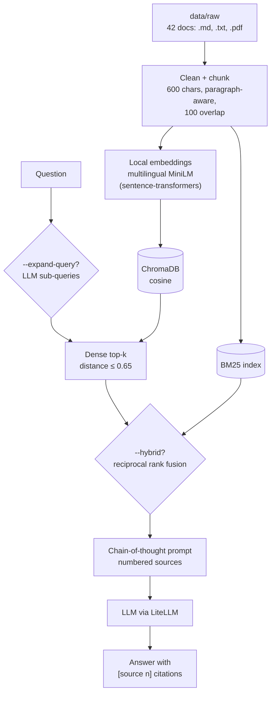

# CypherOG

**A retrieval-augmented question-answering assistant for Popping and funk-style street dance.** It turns scattered web articles, event rulebooks, papers and my own notes into a searchable knowledge base and answers questions with a source cited for every claim.

Course assignment for *Generative AI Application Systems and Engineering* (individual project, April 2026, scored 95.29/100). [中文版 README（完整設計說明）](README.zh-TW.md)

## What it does

- **Ingests mixed sources.** Cleans Markdown, plain text and PDF documents (42 today; the April comparison used the first 39), splits them into 600-character chunks that respect paragraph breaks, and stores them in ChromaDB.
- **Embeds locally.** Uses the multilingual sentence-transformer `paraphrase-multilingual-MiniLM-L12-v2` on the machine, so Chinese questions can match English text and building the index needs no API key.
- **Retrieves with a safety net.** Dense top-5 retrieval with a cosine distance cutoff of 0.65, so off-topic questions get "not covered" instead of a guess.
- **Optional retrieval modes.** `--hybrid` fuses BM25 keyword search with dense search through reciprocal rank fusion; `--expand-query` has an LLM rewrite the question into sub-queries for cross-lingual recall.
- **Answers with citations.** A chain-of-thought prompt lists sourced facts first, then the answer, then what the sources do not cover; generation goes through LiteLLM (Gemini 2.5 Flash by default).

## Pipeline



Hybrid search and query expansion are off by default; the default path is plain dense retrieval (setup E below).

## Results

Five retrieval setups were compared on the same five fixed questions over the same 39 documents (April 2026). Today's code reproduces all 25 retrievals of that run exactly ([round1_reproduction.md](experiments/round1_reproduction.md)).

| Setup | Chunking | Retrieval | Prompt | Mean cosine distance (5 questions) | Q2: Electric Boogaloos members named (of 9) |
|---|---|---|---|---|---|
| A, baseline | fixed 500 chars, no overlap | top-5, no cutoff | weak | 0.399 | 9 |
| B | paragraph-aware 600/100 | top-5, ≤ 0.65 | weak | 0.386 | 9 |
| C | paragraph-aware 1200/200 | top-3, ≤ 0.65 | strong | 0.384 | 3 |
| D | paragraph-aware 300/50 | top-5, ≤ 0.5 | strong | **0.359** | **2** |
| E, chosen | paragraph-aware 600/100 | top-5, ≤ 0.65 | chain-of-thought | 0.386 | 9 |

**Lower distance is not a better answer.** D cut mean cosine distance by 10% against the baseline, yet its answer listed two group members versus the baseline's nine: small chunks broke the member list apart. D also changed five settings at once, so the 10% cannot be credited to chunk size alone. The nine members are the names listed in the corpus, not a verified answer key.

A follow-up round in November 2026 (three runs per setup, metrics registered in [gold.json](experiments/gold.json) before running) tested the optional modes. Hybrid search retrieved Juste Debout facts that every dense-only setup missed, but named only 3 of 9 members; query expansion was unstable across runs. Both therefore stay opt-in. Full tables: [experiments/metrics.md](experiments/metrics.md) and [experiments/README.md](experiments/README.md).

## Quick start

Python 3.10 or newer. The embedding model downloads once from Hugging Face; only answer generation needs an LLM key.

```bash
python -m venv .venv && source .venv/bin/activate
pip install -r requirements.txt
cp .env.example .env        # set a LiteLLM proxy, or OPENAI_API_KEY / GEMINI_API_KEY plus LITELLM_MODEL

python data_update.py --rebuild --reuse-processed   # chunk, embed and index the committed text (no API calls)
python rag_query.py -q "Who founded the Electric Boogaloos?"            # needs the LLM key
python rag_query.py -q "Juste Debout 比賽的規則和歷史？" --hybrid
python -m pytest            # offline tests
```

To reproduce the April retrievals without calling an LLM:

```bash
python experiment_runner.py --combos a b c d e --corpus round1 --retrieval-only --out experiments/round1_reproduction_run
python rag_eval.py --check-reproduction experiments/round1_reproduction_run
```

## Limitations

- **Tiny evaluation.** Five fixed questions, with pre-registered scoring only for two of them; the results illustrate trade-offs, not general accuracy.
- **Embeddings see only the first 128 tokens** of each chunk, so roughly a fifth of a 600-character chunk never reaches dense retrieval.
- **Mostly English sources** (about 99% of characters); Chinese appears only in my own notes, and BM25 splits Chinese into single characters.
- **Static snapshot** of 2024–2025 web pages; no automatic updates, and nothing about what a move looks like.

## Repository layout

| Path | Contents |
|---|---|
| `data_update.py` | Clean, chunk, embed, write ChromaDB and the BM25 index |
| `rag_query.py` | Question-answering CLI (dense, `--hybrid`, `--expand-query`) |
| `rag_common.py` | Shared settings: paths, embedding model, Chroma, BM25, LiteLLM |
| `skill_builder.py` | Summarizes the knowledge base into an agent skill file through fixed questions |
| `experiment_runner.py`, `rag_eval.py` | Rebuild each setup, run the five questions, score with pre-registered metrics |
| `experiments/` | April outputs (`combo_a`–`combo_e`), reproduction check, November runs (`round2/`), metrics |
| `data/raw`, `data/processed` | Source documents and their cleaned text (per-file sources, URLs and licences in [`data/SOURCES.md`](data/SOURCES.md); category summary in the [Chinese README](README.zh-TW.md#5-資料來源聲明data-sources-statement)) |
| `tests/` | pytest suite (chunking, fusion, BM25, experiments, evaluation) |

**Role:** individual project. I built the ingestion pipeline, retrieval and prompts. The November 2026 extension (retrieval fixes, tests, the evaluation harness and the follow-up experiments) was built with an AI coding agent (Claude Code) under my direction.
